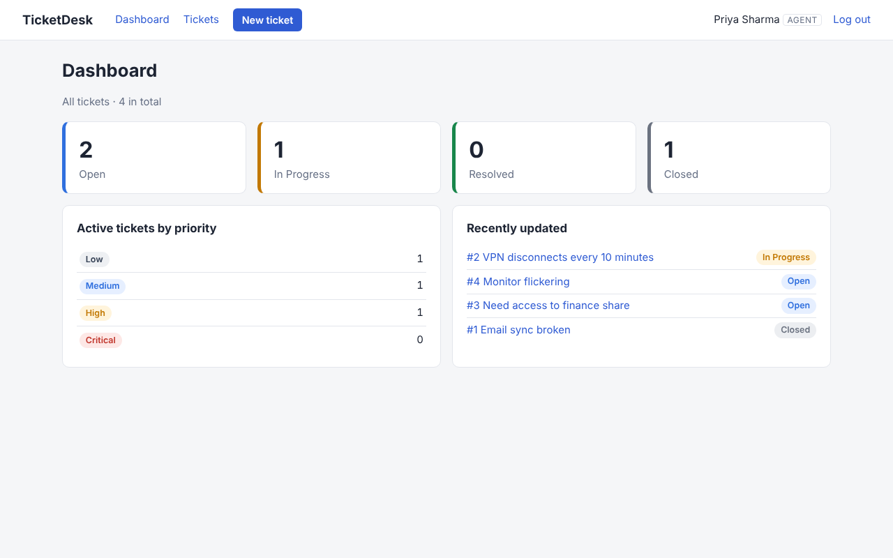

# Project TicketDesk — Python (FastAPI) stream

A lightweight IT support ticket tracker and its full AWS deployment for the
**Project TicketDesk Engineer POC**: Terraform-provisioned VPC, Dockerised app on EC2 behind nginx,
private Amazon RDS PostgreSQL 16, versioned S3 attachment storage, an S3-triggered Lambda file
processor, CloudWatch logs/dashboard/alarms, and GitHub Actions CI/CD with OIDC.

**Team:** Taanmay Shivam · Bishwadeep Ghosh · Asmit Srivastava  
**Repository:** https://github.com/tonmoyShivam/TicketDesk



## Application features

| Feature | Where |
|---|---|
| User login (sessions, PBKDF2 password hashes, CSRF protection) | `app/routes.py`, `app/security.py` |
| Create ticket, view tickets (search + status filter) | `/tickets/new`, `/tickets` |
| Status workflow Open → In Progress → Resolved → Closed (with reopen) | `app/models.py` `TRANSITIONS` |
| Dashboard summary (by status, by priority, recent) | `/dashboard` |
| File attachments (local disk or S3) with Lambda processing result per file | `app/storage.py`, `lambda/` |
| Roles: `user` (employee) sees own tickets; `agent`/`admin` see all and change status | RBAC stretch goal |
| Health check | `/health` |

## Repository layout

```
app/                    FastAPI application (routes, models, config, storage, templates)
scripts/                init_db.py (apply schema), create_user.py
sql/schema.sql          PostgreSQL schema
lambda/                 S3-triggered file processor (type, size, magic-byte check, SHA-256, tags)
terraform/              Infrastructure as code (51 resources by default)
  modules/network       VPC, public + 2 private subnets, routing (no NAT Gateway)
  modules/security      app and DB security groups
  modules/iam           EC2 instance role/profile, GitHub OIDC deploy role
  modules/rds           PostgreSQL 16, managed master secret, backups, log export
  modules/s3            private, encrypted, versioned bucket + lifecycle + TLS-only policy
  modules/lambda        function, role, S3 event notification
  modules/cloudwatch    app log group, metric filters, alarms + SNS, dashboard
  modules/ec2           Amazon Linux 2023 instance + bootstrap user data
  tests/                offline `terraform test` with a mocked AWS provider
deploy/ec2/             docker-compose.prod.yml, nginx.conf, install/update/create_user scripts
deploy/aws/             deploy.sh (terraform apply), redeploy_app.sh (SSM), teardown.sh (destroy)
.github/workflows/      ci.yml (pytest, terraform validate/test, docker build), deploy.yml (OIDC + SSM)
docs/                   deployment guide, architecture & security, test plan, troubleshooting, report
tests/                  pytest suite (app, Lambda, Terraform layout, secret scan)
```

## Run it locally (M0–M1)

Requires Python 3.11+ and Docker. No Docker? Use the SQLite line in `.env.example`.

```bash
python -m venv .venv && source .venv/bin/activate      # Windows: .venv\Scripts\activate
pip install -r requirements-dev.txt
cp .env.example .env            # set SECRET_KEY and LOCAL_DB_PASSWORD (instructions inside)

docker compose up -d db                                 # local PostgreSQL 16
python -m scripts.init_db
python -m scripts.create_user admin --role admin --full-name "Admin"
python -m scripts.create_user agent1 --role agent --full-name "Support Agent"
python -m scripts.create_user ravi --full-name "Ravi Kumar"
uvicorn app.main:create_app --factory --reload          # http://127.0.0.1:8000
```

Tests: `pytest -q` · Terraform: `cd terraform && terraform init -backend=false && terraform validate && terraform test`

## Deploy on AWS (M2–M5)

```bash
git push                                                # the instance clones the repo (no secrets in it)
cp terraform/terraform.tfvars.example terraform/terraform.tfvars   # fill repo_url and your IP
./deploy/aws/deploy.sh                                  # terraform init + apply (~15-20 min, mostly RDS)
./deploy/aws/redeploy_app.sh                            # later code changes (or let GitHub Actions do it)
./deploy/aws/teardown.sh                                # terraform destroy, including all S3 versions
```

Step-by-step: **[docs/DEPLOYMENT.md](docs/DEPLOYMENT.md)**.

## Documentation

- [docs/DEPLOYMENT.md](docs/DEPLOYMENT.md) — every milestone, M0 to M5, plus CI/CD setup
- [docs/ARCHITECTURE_AND_SECURITY.md](docs/ARCHITECTURE_AND_SECURITY.md) — architecture, IAM, the five pass/fail rules
- [docs/TEST_PLAN.md](docs/TEST_PLAN.md) — test cases with result columns
- [docs/TROUBLESHOOTING.md](docs/TROUBLESHOOTING.md) — where the logs are, common failures, issue log
- [docs/Project_TicketDesk_POC_Report.docx](docs/Project_TicketDesk_POC_Report.docx) — submission report
